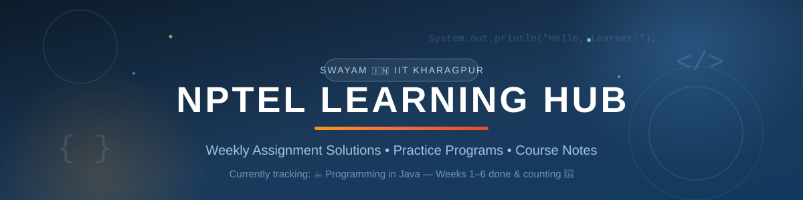

<div align="center">



<br>


</div>

# 🎓 Nptel_learning

> A clean, organized collection of my **NPTEL (National Programme on Technology Enhanced Learning)** coursework — weekly assignment solutions, practice programs, and notes. Built week-by-week, course-by-course. 📈

---

## 📚 Course Catalog

| # | Course | Institute | Progress | Status | Solutions |
|---|--------|-----------|----------|--------|-----------|
| 1️⃣ | ☕ **Programming in Java** | IIT Kharagpur | `12 / 12 weeks` | ✅ Completed | [Folder](<Programming In Java>) |
| 2️⃣ | 🇳🇵 *Upcoming — next NPTEL course* | — | — | 🔜 Planned | — |
| 3️⃣ | 🏗 *Reserved for future courses* | — | — | — | — |

> 💡 **Maintained for the future:** every new NPTEL course I enroll in gets its own folder (e.g. `Programming In Python/`) and a new row in this catalog. This repo will grow into a complete NPTEL learning archive.

---

## ☕ Programming in Java — NPTEL (IIT Kharagpur)

*Instructor: Prof. Debasis Samanta, IIT Kharagpur*

Each week contains hands-on assignment programs (`j1.java` → `j5.java`) solving the week's coding problems. Some files include my **original buggy attempt + documented fixes** — a personal "error journal" explaining *why* the fix works. 🔍

| Week | Topics Covered | Programs | Status |
|:----:|----------------|:--------:|:------:|
| **1** | Introduction, I/O, `Scanner`, conditionals | [week1 📁](<Programming In Java/week1>) (5) | ✅ |
| **2** | Arithmetic, operators, expressions & computation | [week2 📁](<Programming In Java/week2>) (5) | ✅ |
| **3** | Iterative statements — `while`, loops, digit counting | [week3 📁](<Programming In Java/week3>) (4) | ✅ |
| **4** | Classes & objects — creating and using custom classes | [week 4 📁](<Programming In Java/week 4>) (5) | ✅ |
| **5** | Methods, static context, recursion (GCD), exact-output matching | [week 5 📁](<Programming In Java/week 5>) (5) | ✅ |
| **6** | Exception handling — `try/catch`, `throw`, `Exception` vs `exception` | [week 6 📁](<Programming In Java/week 6>) (5) | ✅ |
| **7** | Strings & text processing — finding the longest word, `split()` | [week 7 📁](<Programming In Java/week 7>) (5) | ✅ |
| **8** | Multithreading — `Thread`, `Runnable`, `start()`, thread classes | [week 8 📁](<Programming In Java/week 8>) (5) | ✅ |
| **9** | 2D arrays & matrices — flipping values, nested loops | [week 9 📁](<Programming In Java/week 9>) (5) | ✅ |
| **10** | JDBC & databases — `java.sql` package, imports, connectivity | [week 10 📁](<Programming In Java/week 10>) (5) | ✅ |
| **11** | JDBC in action — `Connection`, `Statement`, executing SQL, exception handling | [week 11 📁](<Programming In Java/week 11>) (5) | ✅ |
| **12** | Mixed practice — classes & objects, nested conditionals, arrays | [week 12 📁](<Programming In Java/week 12>) (5) | ✅ |

> 📝 **Note:** the folder names originally drifted (`week1` vs `week 4`) — kept as-is so old links don't break. Total: **59 solved programs** across all 12 weeks. 🎉

<div align="center">


</div>

---

## 🗂 Repository Structure

```text
📦 Nptel_learning
├── 📁 assets/                  ← banners & images for this README
├── 📔 README.md
└── ☕ Programming In Java/
    ├── 📁 week1/               ← j1–j5 · basics & conditionals
    ├── 📁 week2/               ← j1–j5 · operators & expressions
    ├── 📁 week3/               ← j1–j5* · loops & iteration
    ├── 📁 week 4/              ← j1–j5 · classes & objects
    ├── 📁 week 5/              ← j1–j5 · methods & recursion
    ├── 📁 week 6/              ← j1–j5 · exception handling
    ├── 📁 week 7/              ← j1–j5 · strings & text processing
    ├── 📁 week 8/              ← j1–j5 · multithreading
    ├── 📁 week 9/              ← j1–j5 · 2D arrays & matrices
    ├── 📁 week 10/             ← j1–j5 · JDBC & java.sql
    ├── 📁 week 11/             ← j1–j5 · JDBC & SQLite practice
    └── 📁 week 12/             ← j1–j5 · mixed practice
```

---

## 🚀 How to Run

```bash
# 1. Navigate to any week
cd "Programming In Java/week 6"

# 2. Compile
javac j1.java

# 3. Run (most programs read inputs via Scanner)
java j1
```

> Requires **JDK 8 or above**. Programs follow NPTEL's exact input/output formats, so enter test inputs exactly as expected.

---

## 🔮 Roadmap

- [x] Weeks 1–6 of Programming in Java ✅
- [x] Documented error-fix notes in programs (why each fix works) 🔍
- [x] 🏃 Complete Weeks 7–12 of Programming in Java ✅
- [ ] 🎯 Enroll & archive the next NPTEL course
- [ ] 📝 Add end-term / Interim exam prep notes
- [ ] 🧪 Add self-test inputs & expected outputs for every program

---

## 📊 Repo Stats

<div align="center">


</div>

---

## 🤝 Support & Contact

<div align="center">

If this helps your NPTEL prep, please drop a ⭐ — it keeps the motivation going!

[](https://github.com/sujitkr268)
[](https://github.com/sujitkr268/demo-1/issues)

</div>

---

⚠️ **Honor Code:** these solutions are for **learning & reference only**. Please maintain NPTEL's Honor Code — use them to understand the *approach*, not for verbatim submission during graded exams. 🙏

<div align="center">


*Last Updated: October 2026 • Built with 💟 by [sujitkr268](https://github.com/sujitkr268)*

</div>
